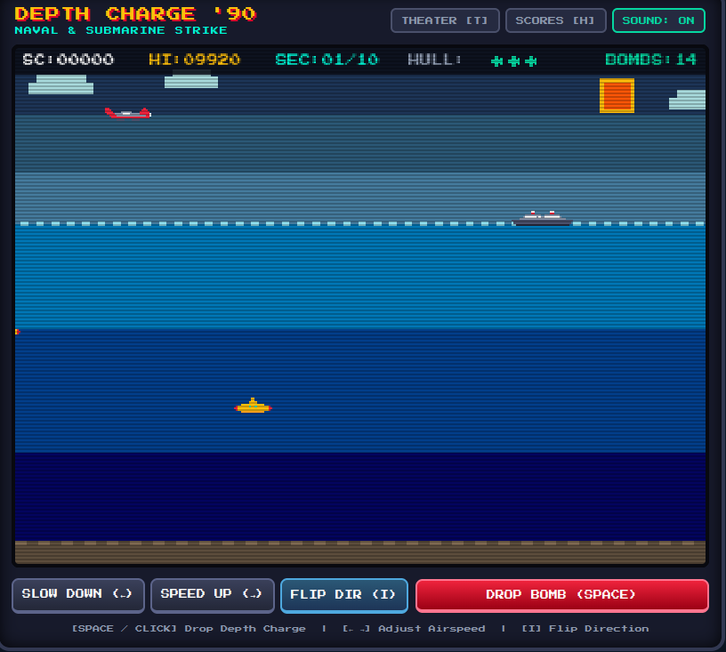

# Depth Charge '90 🚀⚓

[](LICENSE)
[-brightgreen.svg)]()
[]()
[](https://lhackyup.dev/fun/depth-charge-90/)
[](https://buymeacoffee.com/lhackyup)



A retro arcade maritime and space bomber inspired by 1990s Amiga, DOS, and cabinet classics. Built entirely in a **single autonomous HTML5 file** featuring procedurally rendered Canvas pixel art, real-time synthesized sound via the **Web Audio API**, and dual-medium parabolic physics. Zero external assets, zero frameworks, zero dependencies.

🎮 **[Play Instantly in Your Browser (No Install, No Ads)](https://lhackyup.dev/fun/depth-charge-90/)**

---

## ☕ The Story: An AI-Augmented Coffee Break

> *"What happens when an engineer working on Enterprise Architecture (EasyEA) and European agricultural compliance (AgriReg) takes a coffee break? You challenge an AI agent to build a complete 1990s retro arcade game from scratch in a single HTML file."*

Depth Charge '90 is a tribute to the golden era of shareware and arcade gaming. It shows how modern AI workflows can do more than enterprise tools—they can also craft joyful, handcrafted interactive software with zero bloat.

---

## 🌟 3 Thematic Eras / Theaters

Press **`[T]`** anytime on the title screen or during intermission to switch war theaters. Each era features custom pixel art sprites, dedicated Web Audio sound profiles, and atmospheric visuals:

| Era / Theater | Player Craft | Target Fleet | Weapon Profile | Audio Mood |
| :--- | :--- | :--- | :--- | :--- |
| **Atlantic 1943 (`W43`)** | Propeller Torpedo Bomber | WWII U-Boots, Destroyers & Battleships | Hydrostatic Depth Charge Barrels | Warm acoustic engine drone, deep water thuds, cordite Flak puffs |
| **Modern 1990 (`M90`)** | Naval Strike Jet | Nuclear Attack Subs & Missile Cruisers | Finned Smart Bombs | 90s FM arcade sweep, jet turbines, sonar pings, dynamic day/sunset/night/storm weather |
| **Orbital 2190 (`S90`)** | Orbital Star Corvette | Atmospheric Interceptor Drones & Star Dreadnoughts | Pulsating Plasma Darts | Hyperbolic laser ramps, photon torpedoes, glowing ionospheric barrier |

---

## 🛠️ Under the Hood: Technical Architecture

For developers exploring the codebase:

- **100% Procedural Pixel Art (`drawMatrixSprite`)**:
  Every plane, ship, U-boat, and boss is defined as an ASCII character matrix (`const SPRITE_PLANE = [...]`) mapped to a 16-color retro palette. Sprites are rendered dynamically pixel-by-pixel onto a virtual `360x270` CRT Canvas upscaled crisply with `image-rendering: pixelated`.
- **Pure Web Audio API Synthesis (`RetroAudio`)**:
  **Zero `.wav` or `.mp3` files**. Every engine hum, release sound, water splash, torpedo hiss, anti-aircraft Flak burst, and victory fanfare is generated mathematically in real time using Web Audio oscillators (sine, triangle, sawtooth), noise buffer generators, and exponential gain ramps.
- **Dual-Medium Parabolic Physics**:
  - *Upper Medium*: Free parabolic trajectory with gravitational acceleration and light aerodynamic drag.
  - *Boundary (`Y=92`)*: Surface impact with immediate horizontal/vertical velocity damping and dynamic particle splashes.
  - *Lower Medium*: Viscous hydrodynamic drag with terminal underwater sinking speed.
- **10-Sector Progressive Campaign**:
  Enemy fleets evolve across 10 progressive schemas with multi-HP armored ships, submarine counterattacks (rising torpedoes), anti-aircraft Flak, and evasive target maneuvering on Sector 7+.
- **Arcade Hall of Fame**:
  Interactive 3-letter pilot initials entry with slot selection, era tracking (`W43`, `M90`, `S90`), and persistent `localStorage` storage.

---

## 🕹️ Controls

| Action | Keyboard | Touchscreen / Mouse |
| :--- | :--- | :--- |
| **Drop Bomb / Launch Mission** | <kbd>Space</kbd> / <kbd>Enter</kbd> | Click Canvas / `DROP` button |
| **Adjust Airspeed (Slow / Fast)** | <kbd>←</kbd> / <kbd>→</kbd> or <kbd>A</kbd> / <kbd>D</kbd> | `SLOW` / `FAST` tactile buttons |
| **Flip Craft Direction** | <kbd>I</kbd> | `FLIP` button |
| **Select Theater / Era** | <kbd>T</kbd> (then <kbd>1</kbd>, <kbd>2</kbd>, <kbd>3</kbd>) | `THEATER [T]` button / Tap card |
| **Hall of Fame Scores** | <kbd>H</kbd> | `SCORES [H]` button |
| **Toggle Audio** | Click `SOUND` button | `SOUND: ON/OFF` button |

---

## 🚀 Running Locally

No web server or build step required:
```bash
git clone https://github.com/lhackyup/DepthCharge90.git
cd DepthCharge90
# Open directly in any modern browser:
xdg-open depth_charge_90_retro_arcade.html   # Linux
open depth_charge_90_retro_arcade.html       # macOS
start depth_charge_90_retro_arcade.html      # Windows
```

---

<details>
<summary>🇮🇹 <strong>Descrizione in Italiano (Clicca per espandere)</strong></summary>

### 🇮🇹 Panoramica del Progetto

**Depth Charge '90** è un arcade retro ispirato ai grandi classici marittimi dei primi anni '90, realizzato interamente in un **singolo file HTML5** con grafica Canvas pixel art procedurale e motore sonoro sintetizzato in tempo reale tramite **Web Audio API** (nessun asset o file esterno).

- **3 Scenari Storici**: Seconda Guerra Mondiale (`W43`), Battaglia Moderna (`M90`) e Incursione Spaziale Orbitale (`S90`).
- **Fisica a Doppio Mezzo**: Moto parabolico con gravità in aria, smorzamento all'impatto superficiale e trascinamento viscoso in acqua con velocità limite.
- **Campagna a 10 Settori**: Bersagli corazzati con punti ferita multipli, contrattacco nemico (Flak e siluri verticali) e manovre evasive (Settori 7+).
- **Hall of Fame**: Classifica Top 5 con inserimento iniziali da cabinato arcade e tag dell'era di combattimento.
- **Supporto Mobile & Desktop**: Controlli touch integrati su schermo e supporto tastiera completo.

🎮 **[Gioca Subito Online su lhackyup.dev](https://lhackyup.dev/fun/depth-charge-90/)**
</details>

---

## 📄 License

This project is licensed under the **[Creative Commons Attribution-NonCommercial-ShareAlike 4.0 International License (CC BY-NC-SA 4.0)](LICENSE)**.

- **Attribution (BY)**: You must give appropriate credit to **lhackyup** ([https://github.com/lhackyup/DepthCharge90](https://github.com/lhackyup/DepthCharge90)) and indicate if changes were made.
- **NonCommercial (NC)**: You may not use the material for commercial purposes or monetization.
- **ShareAlike (SA)**: If you remix, transform, or build upon the material, you must distribute your contributions under the same license.

---

## ☕ Support & Community

If Depth Charge '90 made you smile during a busy workday or inspired your own creative experiments:

- ☕ **[Support on Buy Me a Coffee](https://buymeacoffee.com/lhackyup)**
- 🌐 Explore more open tools at **[lhackyup.dev](https://lhackyup.dev)**
- ⭐ Leave a star on GitHub if you enjoy retro arcade coding!
